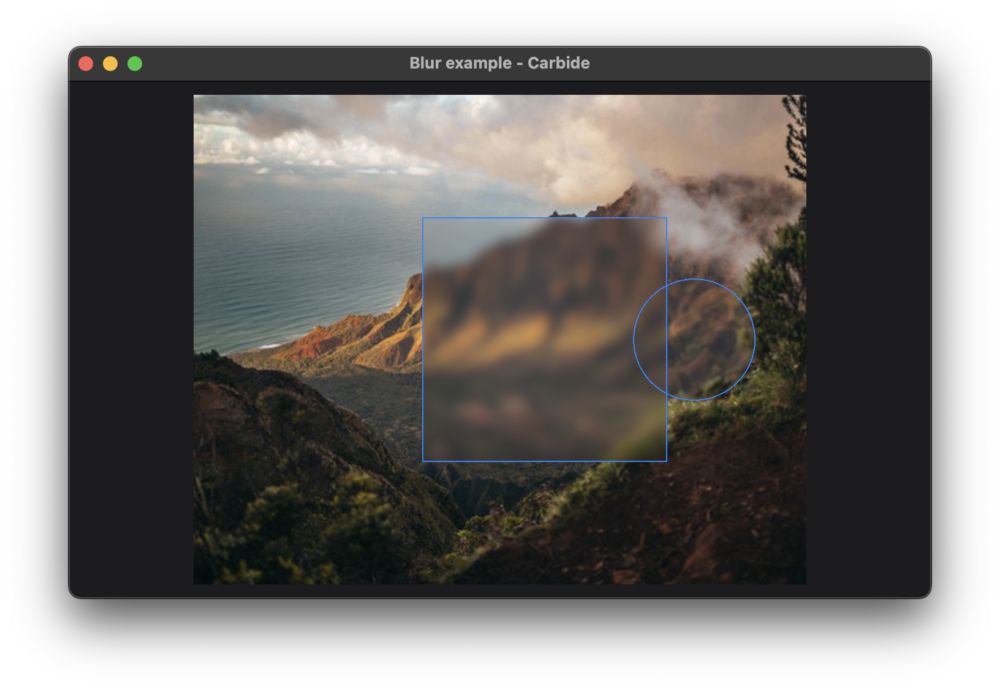

+++
title = "Blur"
+++

# Blur



The blur example shows how to apply a blur rendering effect within a given shape to an area. In the example, we blur an [Image](@/examples/image/image/index.md) within specified moving areas with different blur strengths.

## Explaination
Carbide provides different graphical effects ([Filter](@/examples/drawing/filter/index.md)) that can be used to customize rendering and style your application to your liking. The blur example consist of two shapes, within which a gaussian or box blur is applied.

Another place blurring is used, is for rendering specific [materials](@/examples/drawing/materials/index.md).

In the below code, a mean/box blur effect is given, and clipped to a circle. The effect is constrained to a 100x100 [frame](TODO), and [offset](TODO) with an x coordinate.
```rust
Blur::mean(3)
    .clip_shape(Circle::new())
    .frame(100.0, 100.0)
    .offset(position_neg_x.clone(), 0.0),
```

The offset of the blur effect is animated, to show how the effect is dynamic, and performant.

When multiple blur effects overlap, the are applied on top of each other, making a stronger blur. Using the WGPU rendering backend, the blurs are calculated on the GPU, with different rendering performance optimizations, to allow larger radii blurs. But when the blur radii become very large, they can be taxing on the GPU, and it is recommended to apply multiple blurs on top of each other instead. 

Both Gaussian and Box blurs stack, and the same rendering result can be achieved by combining multiple blurs with a smaller radius instead of a single blur with a large radius.

## Run the example
The example can be run with the following command: `cargo run --package carbide_wgpu --example blur` when located in the working directory `carbide`. 

For better performance, remember to run the example with `--release`.