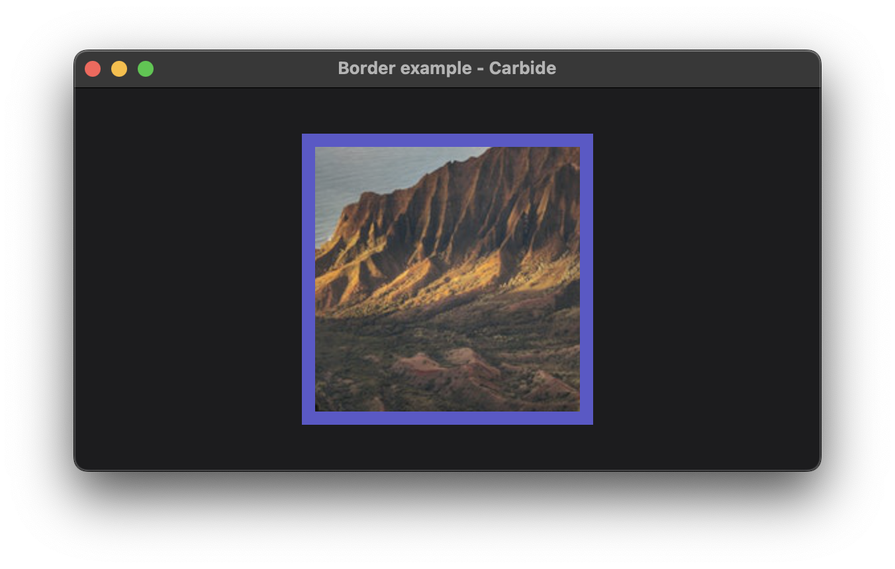

+++
title = "Border"
+++

# Border



The border example shows off the component that draws a border around another widget. The border will always be a rectangle. It is mostly useful for quickly debugging and finding elements.

## Explaination
A border is drawn surrounding the [Image](@/examples/image/image/index.md). By default the border [Color](@/docs/general/colors/index.md) is randomly chosen. The color can be chosed by calling the `.color()` method on the border widget, before or after you set the `.border_width()`.

```rust
Image::new("images/landscape.png")
    .clip()
    .frame(200.0, 200.0)
    .border()
    .border_width(10),
```

The border will shrink to the size of the contained widget, plus its border_width * 2.

## Run the example
The example can be run with the following command: `cargo run --package carbide_wgpu --example border` when located in the working directory `carbide`. 

For better performance, remember to run the example with `--release`.