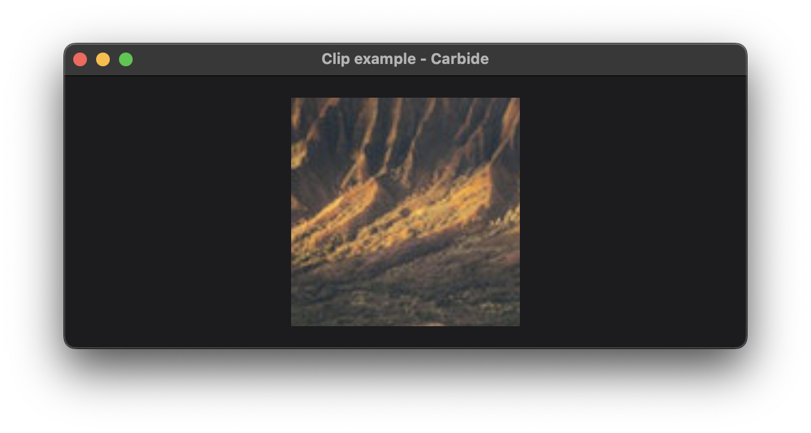

+++
title = "Clip"
+++

# Clip



The clip example, defines a rectancle to be used as clipping. In the example an [Image](@/examples/image/image/index.md) is clipped to a square.

## Explaination
The `.clip()` modifier clips its the content to a given area. The modifier fills its available space, meaning it tries to be as large as possible. In the below example the size chosen is 200x200, since that is the space given by the enclosing [frame](TODO).

```rust
Image::new("images/landscape.png")
    .scaled_to_fill()
    .frame(800.0, 800.0)
    .clip()
    .frame(200.0, 200.0),
```

The [Image](TODO) is also set to fill its available content using the `.scaled_to_fill()` modifier, and fills a frame of size 800x800.

> Clipping is often the most efficient but most inflexible solution. Other solutions such as [ClipShape](@/examples/drawing/clip_shape/index.md) and [Mask](@/examples/drawing/mask/index.md) are more flexible, but comes with their own performance considerations.

When multiple clippings are applied to the same content, the result will be the intersection of the clippings.

> **WARNING:** It is not defined whether you are allowed to transform the clip using a transformation matrix. Currently the WGPU backend does not allow this. This is due to platform optimizations. If you need to transform a rectangle clipping, use [ClipShape](@/examples/drawing/clip_shape/index.md).

## Run the example
The example can be run with the following command: `cargo run --package carbide_wgpu --example clip` when located in the working directory `carbide`. 

For better performance, remember to run the example with `--release`.