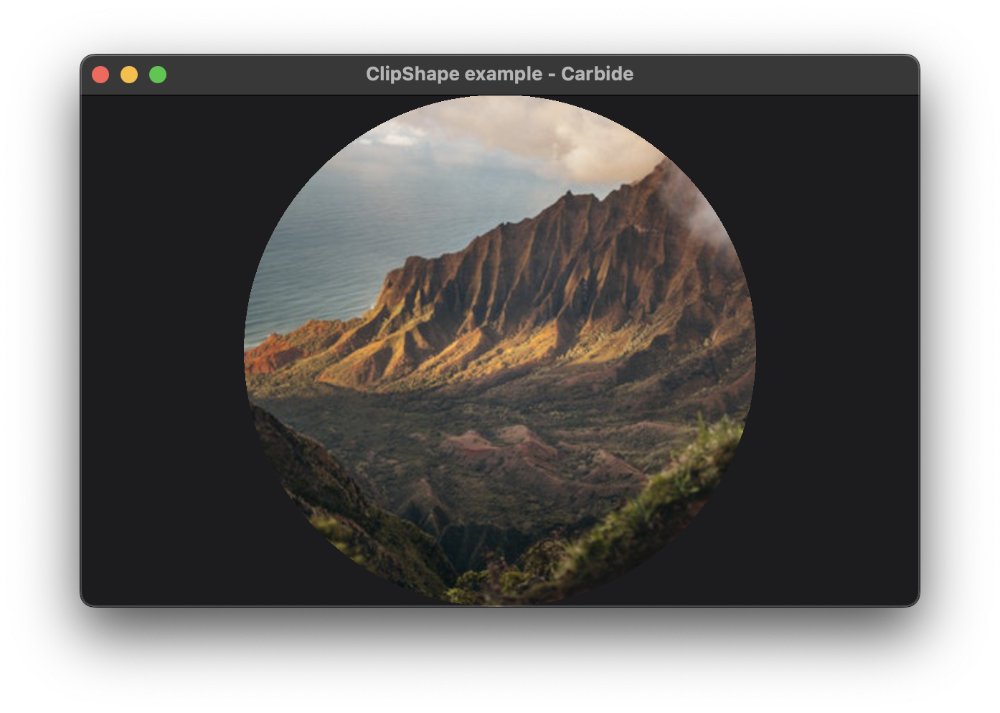

+++
title = "ClipShape"
+++

# ClipShape



The ClipShape example, defines a shape to use for clipping another widget. In the example, the shape chosen is a circle, and the item being clippes is an [Image](@/examples/image/image/index.md). Notice only the image is clipped, and not the background.

## Explaination
The `.clip_shape()` modifier clips its content to a given shape. The modifier fills its available space with the shape, meaning it tries to be as large as possible. In the below example the size chosen is the size of the [Window](TODO).

```rust
Image::new("images/landscape.png")
    .clip_shape(Circle::new())
```

When multiple clip shapes are applied to the same content, the result will be the intersection of the different clip shapes.

The `ClipShape` will react to the current transform matrix. It will render the same way as any other rendering primitives.

> The `ClipShape` is the middleground in performance and flexibility between the [Clip](@/examples/drawing/clip/index.md) and the [Mask](@/examples/drawing/mask/index.md). The complexity of the shape can affect the performance, but due to optimizations renderers can make, will often not be noticed.

## Run the example
The example can be run with the following command: `cargo run --package carbide_wgpu --example clip_shape` when located in the working directory `carbide`. 

For better performance, remember to run the example with `--release`.