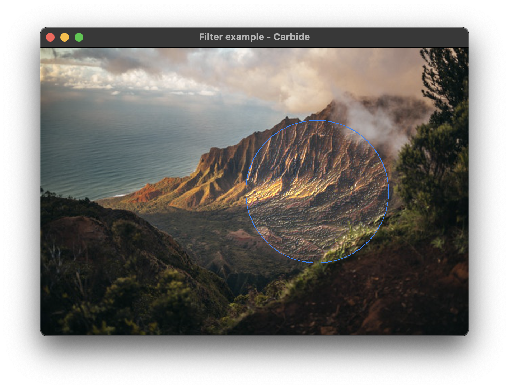

+++
title = "Filter"
+++

# Filter



The filter example shows how to apply a [convolution filter](https://en.wikipedia.org/wiki/Kernel_(image_processing)) to render a graphical effect. The filter applied is a 3x3 sobel filter. The filter is applied on a rendered [Image](@/examples/image/image/index.md).

## Explaination
In the below code, a sobal image filter effect is given, and clipped to a circle. The effect is constrained to a 200x200 [frame](TODO), and [offset](TODO) with an x coordinate.
```rust 
Filter::new(ImageFilter::sobel(), Empty::new())
    .clip_shape(Circle::new())
    .frame(200.0, 200.0)
    .offset(position_x.clone(), 0.0),
```

The offset is animated, making the filter move back and forward across the image, showing the filter is dynamic and performant. 

The filter is applied to already rendered content. For more on renderinger order, see: [Rendering](TODO).

> It is not recommended using the Filter for a blurring effect, even though it is possible. This is because a blur effect defined and used this way is very expensive on the rendering hardware, and may cause slow-downs. Instead we recommend using the [Blur](@/examples/drawing/blur/index.md) effect, as it is optimized specifically for applying blurs.

## Run the example
The example can be run with the following command: `cargo run --package carbide_wgpu --example filter` when located in the working directory `carbide`. 

For better performance, remember to run the example with `--release`.