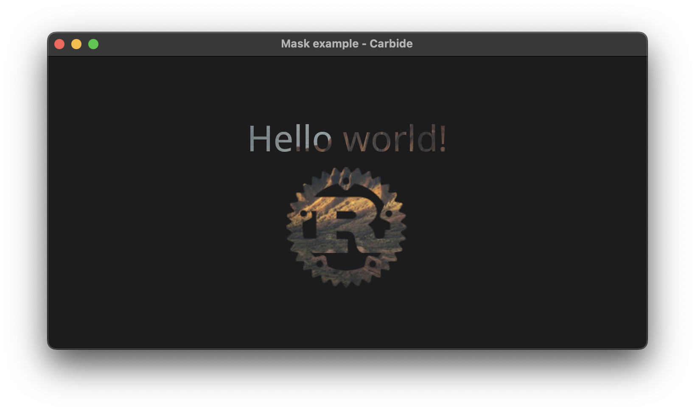

+++
title = "Mask"
+++

# Mask



The mask example shows how a mask can be applied to some underlying content. The mask is generated by rendering some content, and is masking the children.

## Explaination
In the example the mask is applied to an [Image](@/examples/image/image/index.md). The mask contains a [VStack](TODO) containing multiple elements. The stack contains a [Text](TODO) element and another [Image](@/examples/image/image/index.md).

```rust
Image::new("images/landscape.png")
    .mask(VStack::new((
        Text::new("Hello world!")
            .font_size(42),
        Image::new_icon("images/rust.png")
    )))
```

Masking is the most flexible, and most expensive clipping mechanism. Other clipping mechamisms include [Clip](TODO) and [ClipShape](TODO), each with their own performance considerations and limitations.

> It is possible to both apply multiple masks on top of each other, and masking a mask. Both will result in the same rendering result, but is achieved in different ways. The result will be the intersection of the two masks. Applying multiple masks is prefered over masking a mask, since it is easier to optimize the ressource use by the rendering backends.

Masks react to the current transformation, and are transformed as any other rendering primitive.

## Run the example
The example can be run with the following command: `cargo run --package carbide_wgpu --example mask` when located in the working directory `carbide`. 

For better performance, remember to run the example with `--release`.