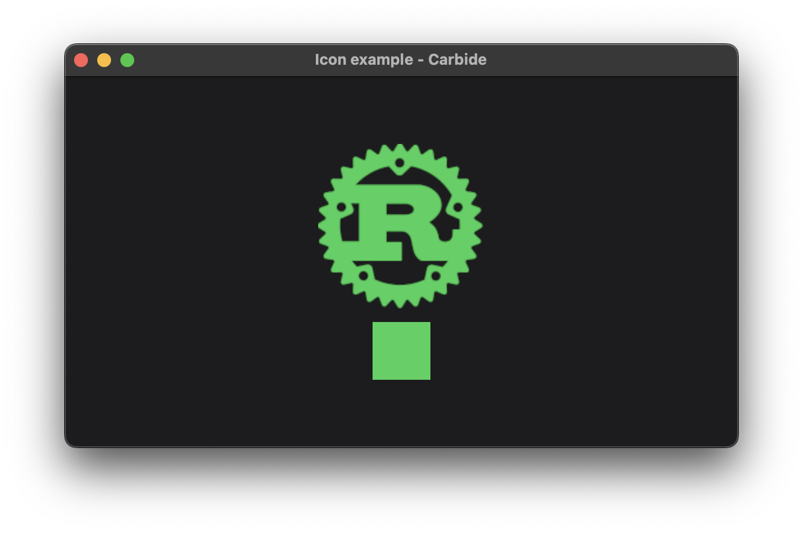

+++
title = "Icon"
+++

# Icon



The icon example shows how to render an [Image](@/examples/image/image/index.md) in icon mode, and coloring it using its opacity to define where to fill, and not fill. The example renders a [VStack](TODO) with an icon, and a rectangle, both in the [EnvironmentColor](@/docs/general/colors/index.md#environmentcolor) green.

## Explaination
When rendering an [Image](@/examples/image/image/index.md), you can derine the image to be rendered in icon mode. When rendering in icon mode, the color of the result is defined by the Label [EnvironmentColor](@/docs/general/colors/index.md#environmentcolor).

```rust
VStack::new((
    Image::new_icon("images/rust.png")
        .foreground_color(EnvironmentColor::Accent),
    Rectangle::new()
        .frame(50.0, 50.0),
)).accent_color(EnvironmentColor::Green)
```

In the above code, we define a [VStack](TODO) with 2 elements. The first element in the stack is an [Image](@/examples/image/image/index.md) that is defined to render in icon mode. The Label [EnvironmentColor](@/docs/general/colors/index.md#environmentcolor) is set to the current Accent [EnvironmentColor](@/docs/general/colors/index.md#environmentcolor). The second element is a 50x50 rectangle, which by default is rendered using the [accent color](@/examples/drawing/accent/index.md). Lastly the accent color is set to the [EnvironmentColor](@/docs/general/colors/index.md#environmentcolor) green for all items in the [VStack](TODO).

> The default color used for the icon is the Label [EnvironmentColor](@/docs/general/colors/index.md#environmentcolor). This is chosen because you often want the same color to be used for the icons as the current [Text](TODO) color. The default [Text](TODO) color is also using the Label [EnvironmentColor](@/docs/general/colors/index.md#environmentcolor).

## Run the example
The example can be run with the following command: `cargo run --package carbide_wgpu --example icon` when located in the working directory `carbide`. 

For better performance, remember to run the example with `--release`.