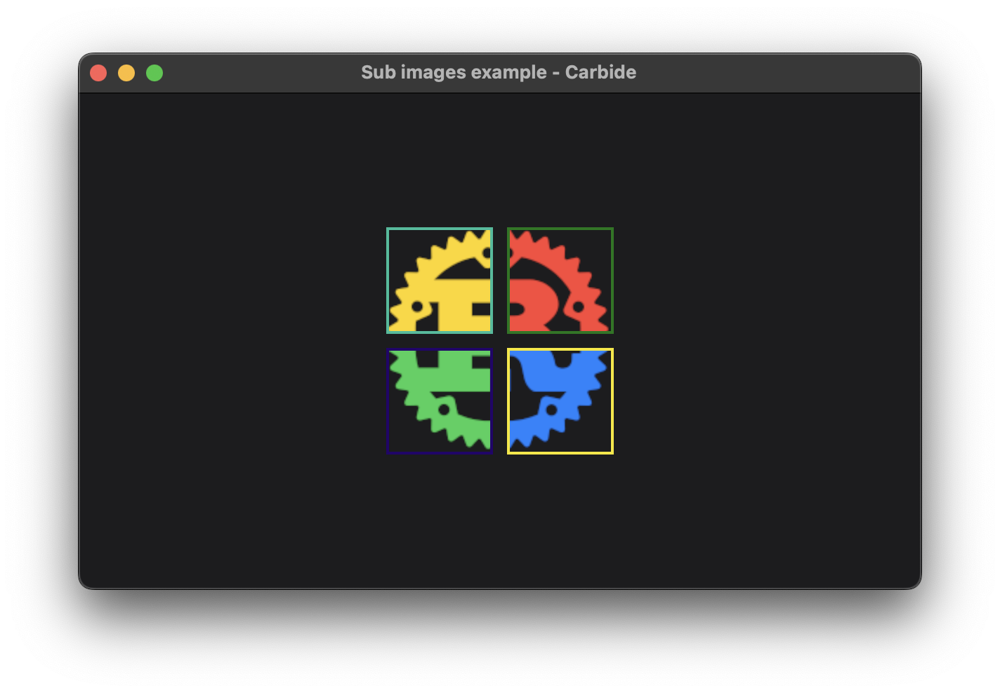

+++
title = "Sub Images"
+++

# Sub Images

## Run the example
The example can be run with the following command: `cargo run --package carbide_wgpu --example sub_images` when located in the working directory `carbide`. 

For better performance, remember to run the example with `--release`.