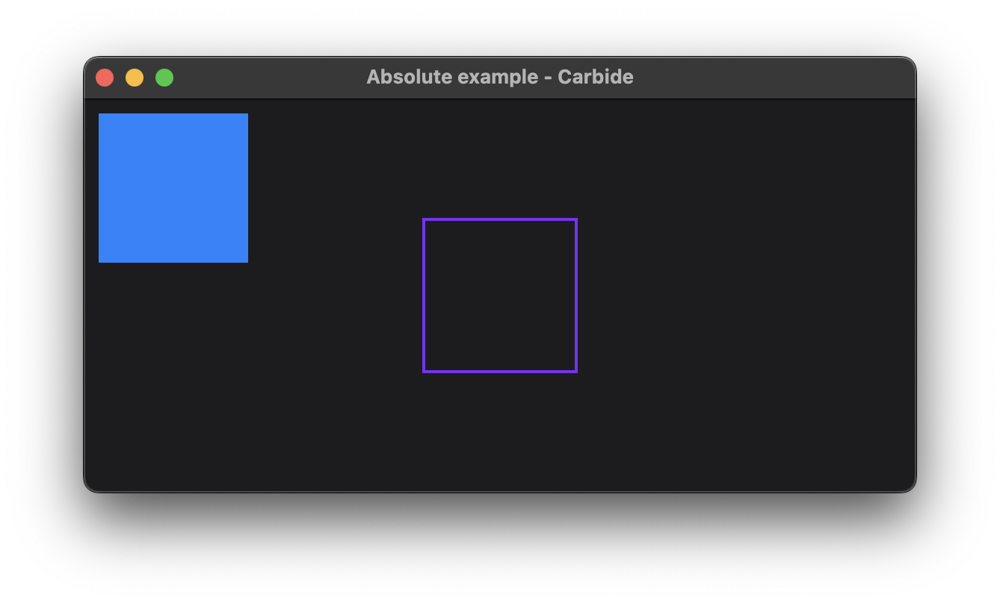

+++
title = "Absolute"
+++

# Absolute

## Run the example
The example can be run with the following command: `cargo run --package carbide_wgpu --example absolute` when located in the working directory `carbide`. 

For better performance, remember to run the example with `--release`.