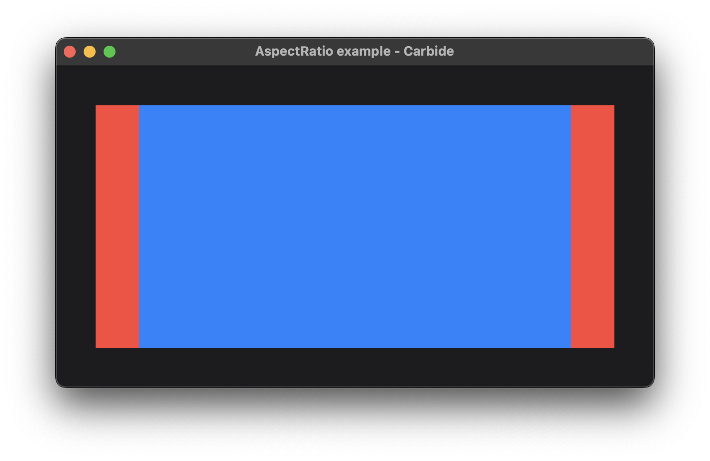

+++
title = "Aspect Ratio"
+++

# Aspect Ratio

## Run the example
The example can be run with the following command: `cargo run --package carbide_wgpu --example aspect_ratio` when located in the working directory `carbide`. 

For better performance, remember to run the example with `--release`.